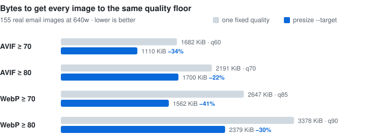

<div align="center">

# presize

**Build-time image optimization that picks the right quality for every image.**

[](https://github.com/jiatastic/presize/actions/workflows/ci.yml)
[](LICENSE)
[](package.json)

</div>

presize turns a folder of images into AVIF and WebP at the widths you actually display, plus a
`presize.json` manifest with `srcset` data and a ThumbHash placeholder for each one. You serve
the files from any static host. There's no image server and no per-image bill.

Most tools use one quality setting for every image. presize scores each encode with
[SSIMULACRA2](https://github.com/cloudinary/ssimulacra2), a perceptual metric, and keeps the
smallest file that still looks right.

<p align="center">
  
</p>

> [!NOTE]
> Pre-release: not on npm yet.

## Quick start

```bash
npm i -D presize
npx presize images --out public/img --display 400 --target 80
```

This makes 400w and 800w (1× and 2×) files in `public/img`. Each one gets the lowest quality
that scores at least 80. Run it again and only new or changed images are encoded.

Then render from the manifest:

```ts
import { type Manifest, picture } from "presize/manifest";
import data from "./public/img/presize.json";

const hero = (data as Manifest).images["brand/hero.jpg"];
picture(hero, { alt: "Hero", sizes: "(max-width: 640px) 100vw, 400px" });
// <picture><source type="image/avif" srcset="…"></picture>
```

`presize/manifest` imports nothing at runtime, so sharp never loads where your pages render.
See [`examples/`](examples) for Next.js, Astro and plain Node.

## Why a quality target

One quality number means different things for different images. AVIF q50 leaves a flat logo
pristine and smears a busy product photo. On the benchmark set, q50 scored 80.5 at the median,
yet 1 in 20 images fell below 68.

With a single setting, you raise it until the worst images look fine, and every easy image
pays for it. `--target` sets a floor instead, and each image spends only what it needs to
reach it.

| Score | Means |
|---|---|
| 90 | visually lossless at normal viewing distance |
| 80 | very high quality |
| 70 | high quality |
| 50 | medium |

## Options

| Flag | Default | |
|---|---|---|
| `--out <dir>` | required | where files and `presize.json` go |
| `--display <px>` | | CSS width the images are shown at; one file per `--dpr` |
| `--dpr <list>` | `1,2` | pixel ratios for `--display` |
| `--widths <list>` | `640,1280` | exact widths instead of `--display` |
| `--target <score>` | | SSIMULACRA2 score every file must reach |
| `--quality <list>` | `avif=50,webp=75` | fixed quality when there's no `--target` |
| `--formats <list>` | `avif,webp` | |
| `--base <url>` | inferred | URL prefix; `./public/img` becomes `/img` |
| `--concurrency <n>` | cores ÷ 4, or ÷ 2 with `--target` | images processed at once |

The same options are available from code as `presize({ input, out, ... })`.

## What it handles for you

- **Never enlarges.** An image narrower than a requested width is served at its own size.
- **Keeps the original when it's smaller.** Small PNGs often grow when re-encoded. The source
  is then served as is.
- **Cache-forever names.** Files are named `name.<hash>.<width>.<format>`.
- **Upright pixels.** EXIF orientation is applied before resizing, and metadata is stripped.
- **Safe cleanup.** Stale files are removed, but only files presize wrote.

<details>
<summary><b>How the quality search works</b></summary>

<br>

- Each image is resized once per width. Every candidate quality encodes those same pixels.
- The score compares the encode against the resized source, so it judges compression, not
  resizing.
- The quality is found by bisection, about 7 encodes per file. The next width starts from the
  last answer.
- Transparent images are scored over white and over black, and the worse score counts.
- Images under 8×8 can't be scored and use `--quality`.
- The manifest records each file's `quality` and `score`.

SSIMULACRA2 is implemented in plain TypeScript, ported from the rust-av crate. On the crate's
reference pair it scores 17.39831, against the crate's 17.398505.

</details>

<details>
<summary><b>Benchmark details</b></summary>

<br>

155 email images (every 12th of a real library: product photos, banners, logos), at 640w,
effort 4. Reproduce with [`bench/`](bench).

| Floor | Fixed quality that gets 95% of files there | `--target`, all files there | |
|---|---|---|---|
| AVIF ≥ 70 | q60 · 1682 KiB | 1110 KiB | **−34%** |
| AVIF ≥ 80 | q70 · 2191 KiB | 1700 KiB | **−22%** |
| WebP ≥ 70 | q85 · 2647 KiB | 1562 KiB | **−41%** |
| WebP ≥ 80 | q90 · 3378 KiB | 2379 KiB | **−30%** |

- At equal scores, AVIF is 71–75% the size of WebP. WebP can't reach 90 on about half the
  images, even at q95.
- Part of the saving comes from easy images landing right at the floor instead of above it.
  Compared by median, `--target 70` AVIF is 10% smaller than fixed q50, with a median score of
  70.9 against 80.5.
- Cost: about 1.4 s per AVIF and 0.7 s per WebP on one core of an M-series laptop, against
  about 0.1 s for a single encode. Unchanged images are skipped on later runs.

</details>

## When not to use it

Images that arrive at runtime, such as user uploads or remote URLs, need an on-request
optimizer like imgproxy or your CDN's image service. presize only handles images you have at
build time.

## License

MIT. The SSIMULACRA2 port keeps the notices of the code it came from; see
[THIRD_PARTY.md](THIRD_PARTY.md). Encoding is done by [sharp](https://sharp.pixelplumbing.com)
(Apache-2.0), which ships libvips (LGPL-3.0) as a separate binary.
