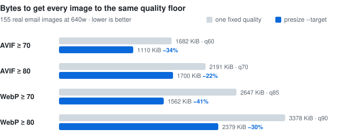

# presize

Build-time image optimization that picks the quality of each image by how it looks.

<p>
  <a href="LICENSE"></a>
  <a href="package.json"></a>
  <a href="CHANGELOG.md"></a>
</p>

presize turns a folder of images into AVIF and WebP files at the widths you display them, and
writes `presize.json` with `srcset` data and a ThumbHash placeholder for each image. You serve
the files from any static host, with no image server and no per-image bill.

Most tools encode every image at one quality. presize scores each encode with
[SSIMULACRA2](https://github.com/cloudinary/ssimulacra2), a perceptual metric, and keeps the
smallest file that reaches the score you ask for.

<picture>
  <source media="(prefers-color-scheme: dark)" srcset="docs/benchmark-dark.svg">
  
</picture>

## Install

```bash
npm install -D presize
```

Requires Node.js 20.9 or later. presize isn't on npm yet; until it is, install it from this
repository.

## Quick start

Run it on a folder of images:

```bash
npx presize images --out public/img --display 400 --target 80
```

```
widths 400, 800 · avif + webp · target score 80 · base "/img"
22 images, 2.3 MiB as sources
  avif  400w 250 KiB (10.4%)  800w 563 KiB (23.5%)  · median q62, score 80.4
  webp  400w 345 KiB (14.4%)  800w 928 KiB (38.6%)  · median q84, score 80.4
22 made, 0 unchanged, 0 failed, 0 old files removed · 29.2s
```

- `--display 400` is the CSS width the images are shown at. presize makes 400w and 800w files
  for 1× and 2× screens.
- `--target 80` gives each file the lowest quality that scores at least 80.
- Run it again and only new or changed images are encoded.

Then render a `<picture>` from the manifest:

```ts
import { type Manifest, picture } from "presize/manifest";
import data from "./public/img/presize.json";

const hero = (data as Manifest).images["brand/hero.jpg"];

picture(hero, { alt: "Hero", sizes: "(max-width: 640px) 100vw, 400px" });
// <picture><source type="image/avif" srcset="…"></picture>
```

`presize/manifest` has no runtime imports, so sharp never loads where your pages render. To
build the element yourself, `pictureSources(entry)` returns `{ avif, srcset, src }`.

| Example | Shows |
| --- | --- |
| [`examples/next`](examples/next) | A Next.js server component that renders `<picture>` with a ThumbHash placeholder |
| [`examples/astro`](examples/astro) | An Astro component, resolved at build time |
| [`examples/node`](examples/node/build.mjs) | The programmatic API and the `picture()` HTML string |

## Choosing a target

| Target | Looks like | Good for |
| --- | --- | --- |
| `90` | Visually lossless at normal viewing distance | Photography, hero images |
| `80` | Very high quality | Most sites |
| `70` | High quality; artifacts show if you look for them | Thumbnails, image-heavy grids |

One quality number means different things for different images. AVIF q50 leaves a flat logo
untouched and smears a busy product photo: on the benchmark set it scored 80.5 at the median,
and 1 in 20 images fell below 68. With one setting, you raise it until the worst image looks
fine, and every easy image pays for that. A target sets a floor instead, and each image spends
only what it needs to reach it.

Without `--target`, presize encodes every image at `--quality` (AVIF 50, WebP 75).

## Options

| Option | Description |
| --- | --- |
| `--out <dir>` | Where the files and `presize.json` go. Required. |
| `--display <px>` | CSS width the images are shown at. Makes one width per `--dpr`. |
| `--dpr <list>` | Pixel ratios for `--display`. Default `1,2`. |
| `--widths <list>` | Exact widths instead of `--display`. Default `640,1280`. |
| `--target <score>` | SSIMULACRA2 score every file must reach. |
| `--quality <list>` | Quality when there's no target. Default `avif=50,webp=75`. |
| `--formats <list>` | Default `avif,webp`. |
| `--base <url>` | URL prefix for `src`. Inferred: `public/img` becomes `/img`. |
| `--concurrency <n>` | Images processed at once. Default: a quarter of the cores, half with `--target`. |

From code, `presize({ input, out, ...options })` takes the same options and returns the
manifest.

## Behavior

- **Never enlarges.** An image narrower than a requested width is served at its own size.
- **Keeps the original when it's smaller.** Small PNGs often grow when re-encoded; then the
  source is served as is.
- **Cache-forever names.** Files are named `name.<hash>.<width>.<format>`.
- **Upright pixels.** EXIF orientation is applied before resizing, and metadata is stripped.
- **Safe cleanup.** Stale files are removed, but only files presize wrote.

## How it works

For each width, presize resizes the image once and keeps those pixels as the reference. It then
finds the lowest quality that reaches the target by bisection, about 7 encodes per file, each
scored against the reference. Because the score compares against the resized source, it judges
the compression, not the resize. The next width starts its search from the last answer.

Transparent images are scored over white and over black, and the lower score counts. Images
under 8×8 pixels can't be scored and use `--quality`. The manifest records each file's
`quality` and `score`.

Encoding is done by [sharp](https://sharp.pixelplumbing.com). SSIMULACRA2 is plain TypeScript,
ported from the [rust-av crate](https://github.com/rust-av/ssimulacra2); on the crate's
reference pair it scores 17.39831 against the crate's 17.398505. Scoring runs in worker
threads.

## Benchmark

155 email images (every 12th of a real library: product photos, banners, logos), at 640w,
effort 4. The fixed column is the lowest quality that gets 95% of files to the floor;
`--target` gets all of them there.

| Floor | Fixed quality | `--target` | Saved |
| --- | --- | --- | --- |
| AVIF ≥ 70 | q60 · 1682 KiB | 1110 KiB | 34% |
| AVIF ≥ 80 | q70 · 2191 KiB | 1700 KiB | 22% |
| WebP ≥ 70 | q85 · 2647 KiB | 1562 KiB | 41% |
| WebP ≥ 80 | q90 · 3378 KiB | 2379 KiB | 30% |

- At equal scores, AVIF is 71–75% the size of WebP. WebP can't reach 90 on about half the
  images, even at q95.
- Part of the saving comes from easy images landing at the floor instead of above it. By
  median, `--target 70` AVIF is 10% smaller than fixed q50, with a median score of 70.9 against
  80.5.
- The search costs about 1.4 s per AVIF and 0.7 s per WebP on one core of an M-series laptop,
  against about 0.1 s for one encode.

Reproduce it with [`bench/`](bench).

## When not to use it

Images that arrive at runtime, such as user uploads or remote URLs, need an on-request
optimizer like imgproxy or your CDN's image service. presize only handles images you have at
build time.

## License

MIT. The SSIMULACRA2 port keeps the notices of the code it came from; see
[THIRD_PARTY.md](THIRD_PARTY.md). sharp is Apache-2.0 and ships libvips (LGPL-3.0) as a
separate binary.
